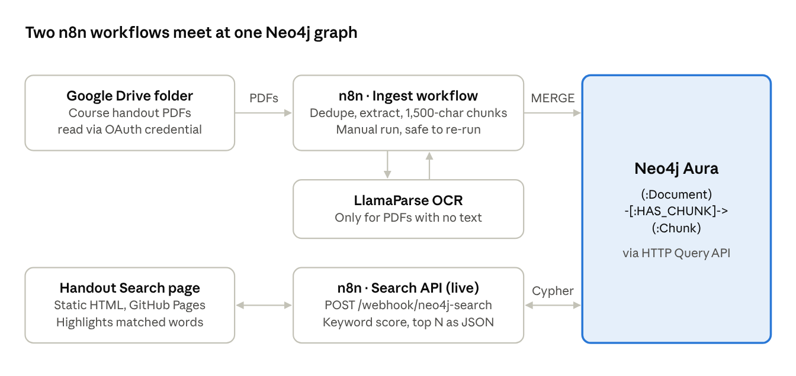

# Week 2 RAG: Handout Search

Oct 18, 2026 · @Dolly

## Overview

Week 2 RAG turns a Google Drive folder of course handout PDFs into a searchable Neo4j knowledge graph, and serves ranked passages to a public search page. It is the retrieval half of a RAG (retrieval-augmented generation) system: the passages it returns are ready to hand to an LLM as context.

- **Ingest:** an n8n workflow reads every PDF in the folder, falls back to OCR for scanned files, cuts the text into overlapping chunks and stores them in Neo4j.
- **Retrieve:** a live n8n webhook takes a query, scores chunks by keyword match in Cypher and returns the top passages as JSON.
- **Search page:** a static page on GitHub Pages ([mpahade/RagSearch](https://github.com/mpahade/RagSearch)) calls the webhook and highlights the matched words. No database credentials live in the repo.
- **Walkthrough:** a 30-second video in the repo, [media/week2-rag-explainer.mp4](https://github.com/mpahade/RagSearch/blob/main/media/week2-rag-explainer.mp4).

## Architecture

The top row writes to the graph on demand; the bottom row reads from it on every search. Neo4j is the only shared piece, and both workflows reach it over the same HTTP Query API and Basic-auth credential.

## Ingestion workflow

**Ingest Drive PDFs into Neo4j** runs on demand (manual trigger, 13 nodes) and is safe to re-run: every write is a MERGE, so a second run updates nodes in place instead of duplicating them.

1. **Start Import:** manual trigger.
2. **List PDFs in Folder:** Google Drive node searches the course folder for `.pdf` files and returns all of them.
3. **Skip Duplicate Copies:** Remove Duplicates node compares file names, so a second upload of the same handout is ingested once.
4. **Download PDF:** pulls each file's binary from Drive.
5. **Extract PDF Text:** Extract From File node reads the PDF with all pages joined into one text.
6. **Has Text?:** if more than 50 non-space characters came out, the text is used as is (**Use Extracted Text**, source `pdf-text`).
   1. Otherwise the file is treated as scanned: **Attach PDF for OCR** re-attaches the binary, **OCR with LlamaParse** parses it on the cost-effective tier, and **Use OCR Text** pulls the markdown or text out of the response (source `llamaparse`).
7. **Split Into Chunks:** a Code node collapses whitespace and cuts 1,500-character chunks with a 200-character overlap. A leading "Copy of " is stripped from the name.
8. **Write to Neo4j:** one HTTP POST per document to the Neo4j Query API (`/db/neo4j/query/v2`, Basic auth). A single Cypher statement MERGEs the Document, UNWINDs the chunk list and MERGEs each Chunk plus its HAS\_CHUNK link.

## Search API and search page

**Neo4j Search API** is the only published workflow: a POST to `https://madhumita.app.n8n.cloud/webhook/neo4j-search` returns ranked passages as JSON, with CORS open to any origin.

1. **Receive Query:** the webhook accepts the query as `?q=…&limit=…` or as a JSON body `{"query": …, "limit": …}`. The limit defaults to 10.
2. **Search Neo4j:** one Cypher statement lower-cases the query and splits it into words longer than two letters. Each chunk scores 1 per word it contains, plus the number of words again when it holds the whole phrase. Chunks scoring 0 are dropped; the rest are sorted by score, then document and chunk number.
3. **Format Results:** a Code node maps the rows to `{document, chunk, text, score}` and scales the score to 0–1 (score ÷ 2 × number of words). A Neo4j error comes back as an `error` field with zero results instead of a failed request.
4. **Send Results:** responds with `{query, count, results}`.

The **Handout Search** page (`index.html` on GitHub Pages) is the front end:

- A query box, a 5 / 10 / 25 results picker, and example chips (time to first token, output tokens, retries).
- It POSTs to the webhook with `q` and `limit` in the URL, then lists each passage with its document name and chunk number.
- Matched query words are wrapped in `<mark>` highlights; the page has light and dark themes.
- The webhook address is editable under **Webhook address**, with a Reset back to the default.

## Data model in Neo4j

The graph has two node labels and one relationship: `(:Document)-[:HAS_CHUNK]->(:Chunk)`, on a Neo4j Aura instance reached through its HTTP Query API.

| Element | Key (MERGE on) | Properties |
| --- | --- | --- |
| `Document` | `name` (file name, "Copy of " stripped) | `driveId`, `pages` |
| `Chunk` | `id` = `<name>#<index>` | `text` (≤ 1,500 characters), `index` |
| `HAS_CHUNK` | one per Document–Chunk pair | none |

Because chunk ids are built from the document name and position, re-ingesting a file overwrites its chunks in place. If a file gets shorter, its old trailing chunks stay in the graph.

## Project progress

The project was built step by step on Oct 18, 2026. Each step below is in the order it happened, with what it delivered.

1. **Started an ingestion workflow.** Created *StudyCompanion-Ingestion* with a manual trigger. It never grew past that; the design moved to reading straight from Google Drive.
2. **Connected to Neo4j.** Built *Neo4j Connection Test*, which sends `RETURN 1 AS ok` to the Aura HTTP Query API. This set up the Basic-auth credential and the HTTP route every later workflow reuses.
3. **Tried a CSV importer.** Built *Import CSV files into Neo4j*: read local CSVs, collect the rows, write them in one batched UNWIND/MERGE request. It proved the batch-write pattern but was left with placeholders.
4. **Built the PDF ingestion pipeline.** Created *Ingest Drive PDFs into Neo4j* with 8 nodes: list PDFs in the Drive folder, skip duplicate copies, download, extract text, split into 1,500-character chunks with 200 overlap, and MERGE Document and Chunk nodes.
5. **Wired it up in the editor.** Manual edits in n8n (three autosaves) to connect the Google Drive and Neo4j credentials. Handouts with readable text now landed in the graph.
6. **Exposed search as an API.** Created and published *Neo4j Search API*: a webhook that scores chunks by keyword match in Cypher and returns the top passages as JSON.
7. **Made the API browser-friendly.** The webhook now reads `q` and `limit` from the URL as well as the JSON body, so a web page can call it without a CORS preflight.
8. **Launched the search page.** Pushed *Handout Search* (`index.html`) to the [RagSearch](https://github.com/mpahade/RagSearch) repo on GitHub Pages: query box, result-count picker, example chips and highlighted matches.
9. **Handled scanned PDFs.** Some handouts (Canva exports, scans) came out with no text and produced no chunks. Added a *Has Text?* check that sends those files to LlamaParse OCR; the workflow grew to 13 nodes.
10. **Recorded a walkthrough video.** Added a 30-second explainer to the repo under `media/` and linked it from the README.
11. **Wrote this document.** Overview, architecture, workflow steps, data model and this progress log.
